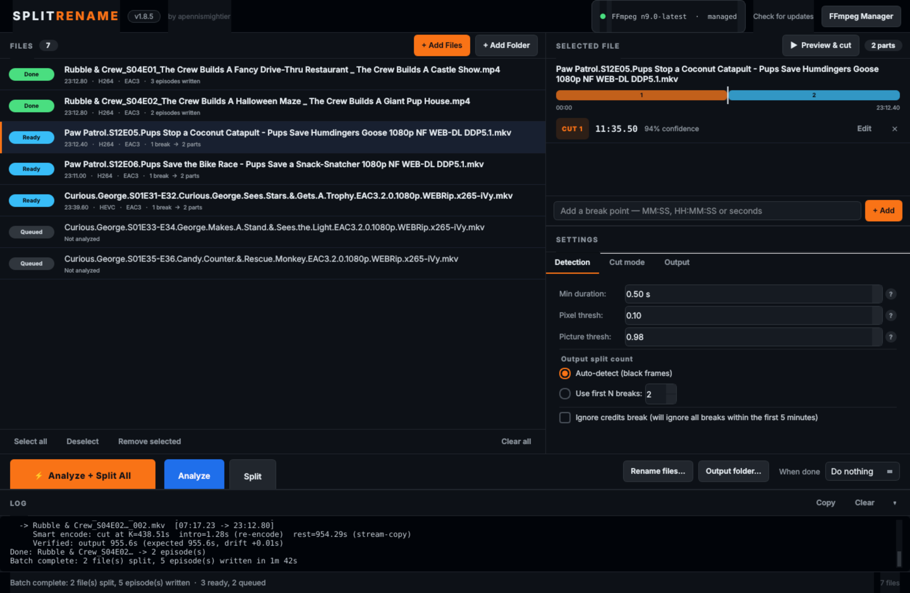
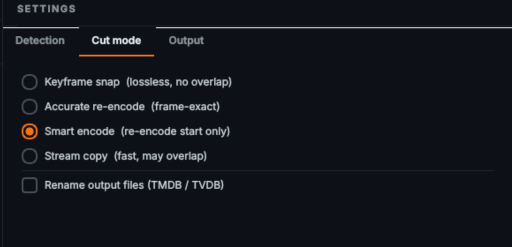
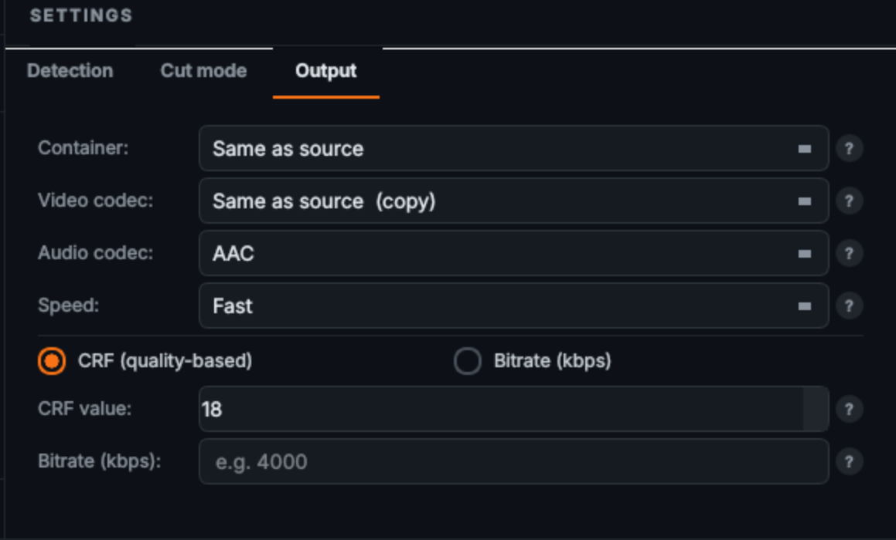
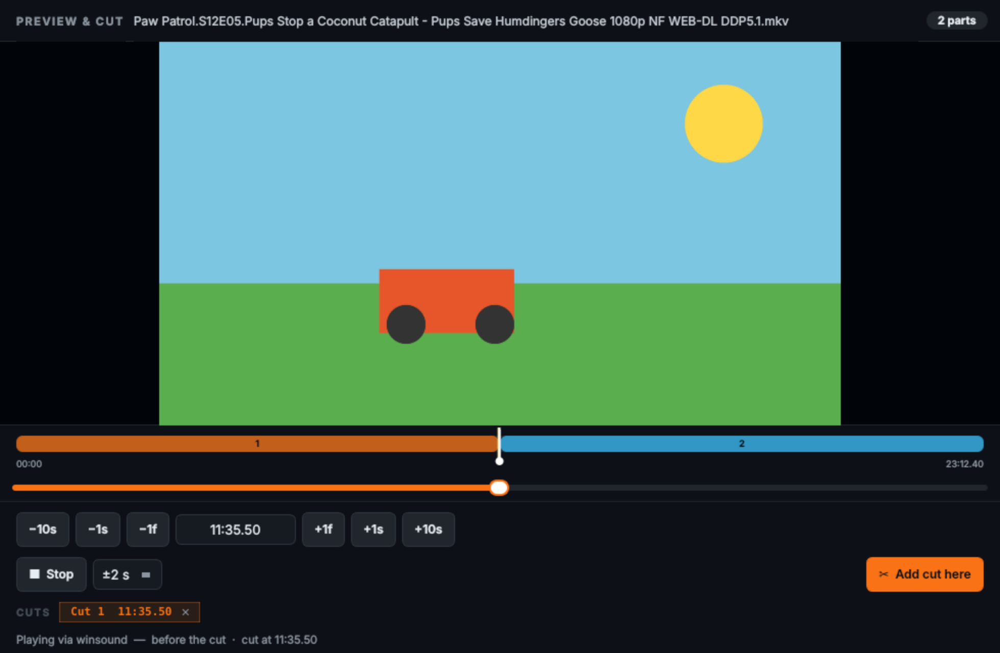
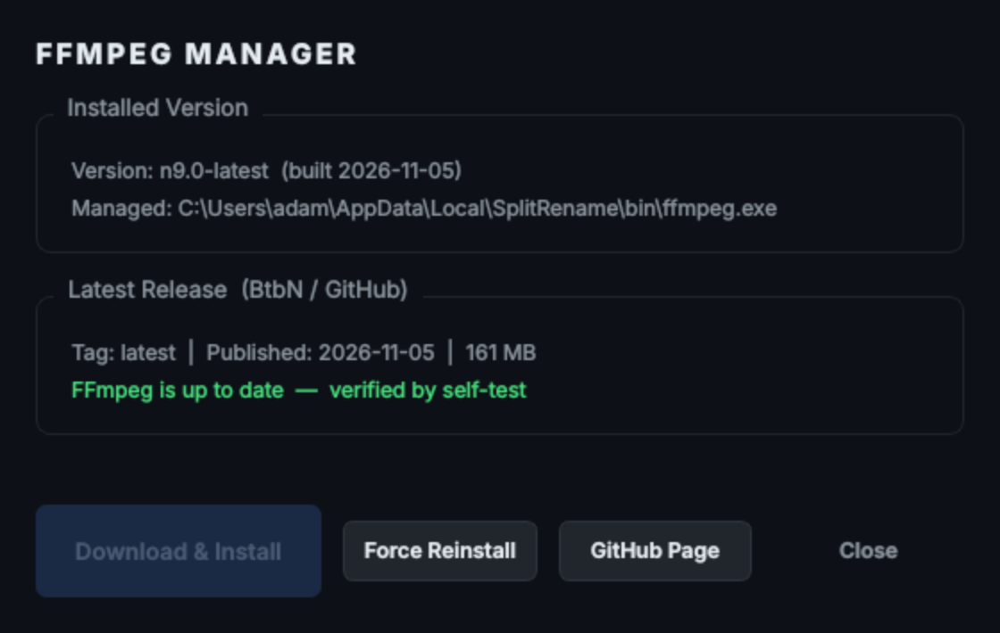

# SPLIT**RENAME**
### by apennismightier

A Windows desktop app that splits multi-episode video files at black-frame boundaries and renames the output files using real episode titles from TMDB and TVDB.



---

## Table of Contents
- [What It Does](#what-it-does)
- [File Management](#-file-management)
- [Black Frame Detection](#-black-frame-detection)
- [Cut Modes](#️-cut-modes)
- [Output Encoding](#️-output-encoding-options)
- [Split Count Control](#-split-count-control)
- [Batch Processing](#-batch-processing)
- [Manual Split Points](#️-manual-split-points)
- [Preview & Cut](#-preview--cut)
- [Episode Renaming](#️-episode-renaming--tmdb--tvdb)
- [Subtitles & Language Tags](#-subtitles--language-tags)
- [Power Management](#-power-management)
- [Cancel](#-cancel)
- [FFmpeg Manager](#️-ffmpeg-manager)
- [App Updates](#-app-updates)
- [Built-in Help](#-built-in-help)
- [Requirements](#requirements)
- [Installation](#installation)
- [Tests](#tests)

---

## What It Does

SplitRename takes video files containing multiple TV episodes — e.g. `Show.S01E01-E02.mkv` — detects the black frames between episodes, splits them into individual files, and renames the output using real episode titles fetched from TMDB or TVDB.

It's part HandBrake, part MKVToolNix, part FileBot, plus an automated break detector. **Smart Encode** gives you the exact cut you want almost as quickly as a stream copy — without the few seconds of the previous episode that keyframe-only splitting leaves at the start of every file.

---

## 📂 File Management

- Drag and drop video files or folders directly into the app
- Supports **MKV, MP4, AVI, MOV, TS, M2TS, WMV**
- Multi-select files for batch processing
- Every file row shows its duration, video/audio codec, detected breaks and a live status pill:

```
Queued  →  Analyzing  →  Ready  →  Splitting  →  Done  /  Error
```

---

## 🔍 Black Frame Detection

The app scans each video for the black frames that appear between episodes and uses them as cut points. Three tunable settings — each has a **?** help button:

| Setting | Description | Default |
|---|---|---|
| Min Duration | Seconds of black that must appear to count as a break | 0.50 s |
| Pixel Threshold | How dark each pixel must be to count as "black" | 0.10 |
| Picture Threshold | Fraction of the frame that must be dark | 0.98 |

Each detected break is shown with its timecode and a **confidence** score (how long and how black the gap was).

### Ignore Credits Break

Check **"Ignore credits break (will ignore all breaks within the first 5 minutes)"** to prevent opening credits from being detected as a split point. Useful for shows that have a black frame after the cold open or title card.

---

## ✂️ Cut Modes



| Mode | Speed | Quality | Notes |
|---|---|---|---|
| **Keyframe Snap** | Fastest | Lossless | Cuts at the nearest keyframe inside the black gap — recommended for most use |
| **Smart Encode** | Fast | Near-lossless | Re-encodes only the first few seconds at each cut, copies the rest |
| **Accurate Re-encode** | Slow | Configurable | Full re-encode for frame-exact cuts |
| **Stream Copy** | Fastest | Lossless | May start a few seconds before the actual cut point |

In the copy modes, every cut is resolved to the keyframe the decoder will *actually* land on (measured per file, since MKV and MP4 seek differently), so segment lengths are exact and nothing from the previous episode is replayed.

### Smart Encode — How It Works

Smart Encode achieves frame-accurate cuts without a full re-encode:

1. Probes the source file to find the exact keyframe (`K`) after the cut point
2. Re-encodes only the opening seconds of each segment, from the cut up to `K` (typically 1–5 seconds)
3. Stream-copies the rest of the segment directly — fast, no quality loss
4. Concatenates both parts using MKV intermediates to avoid timestamp issues
5. Remuxes to your chosen output container and verifies the output duration against the expected length

Handles H.264, H.265/HEVC and AV1 video, and transcodes EAC3/AC3/DTS audio to AAC so both halves of the join match.

### Rename Output Files

Check **"Rename output files (TMDB / TVDB)"** on the Cut mode tab to automatically open the Episode Renaming dialog after splitting, pre-loaded with the freshly split files.

---

## 🎛️ Output Encoding Options



| Setting | Options |
|---|---|
| Container | Same as source · MP4 · MKV |
| Video Codec | Same as source (copy) · H.264 · H.265 · HEVC NVENC (GPU) · AV1 |
| Audio Codec | AAC · AC3 (Dolby) · Copy |
| Speed Preset | Lossless → Ultra Fast → Fast → Medium → Very Slow |
| Quality Mode | CRF (quality-based) or fixed Bitrate (kbps) |

---

## 🔢 Split Count Control

- **Auto-detect** — splits at every detected black frame
- **Use first N breaks** — if a file has 3 detected breaks but you only want 2 output files, set N=2 and only the first break is used

---

## ⚡ Batch Processing

| Button | What It Does |
|---|---|
| **Analyze + Split All** | Fully automated — analyze then split every file in one shot |
| **Analyze** | Scans every queued (not yet analyzed) file for break points with no splitting — review timecodes first |
| **Split** | Splits the files that are ready, using the cuts shown in the inspector |

Progress, per-file status and a full FFmpeg log are shown at the bottom of the window. The log can be copied with one click when you need to report a problem.

---

## ✏️ Manual Split Points

The right-hand panel shows detected break points for whichever file is selected, with a timeline bar showing where each cut falls. You can edit the split list at any time:

- **Edit** any timecode — click Edit and type a new time in `MM:SS` or `HH:MM:SS`
- **×** removes any break point you don't want
- **+ Add** — type any timecode in the input box to insert a manual split point

### Splitting Without Analysis

You don't need to run Analyze first. Add a file, type a timecode in the split point box, and click **+ Add**. The Split button activates immediately. Clicking Split probes the file on the fly and cuts at your manual point — no full black frame scan needed.

---

## 🎬 Preview & Cut



Click **▶ Preview & cut** in the inspector to open a frame-accurate preview of the selected file:

- Scrub the slider for a fast keyframe preview; release it to load the exact frame
- Step with **−10s / −1s / −1f / +1f / +1s / +10s**, or type a timecode directly
- **Add cut here** inserts a split at the exact frame you're looking at
- Existing cuts appear as chips — click a chip to jump to it, or **×** to remove it
- **Audio audition** — press **▶ Play** to hear ±2 s (configurable) of audio around the current position, so you can tell whether dialogue or music runs into the black frames before committing a cut

---

## 🏷️ Episode Renaming — TMDB / TVDB

A built-in FileBot-style renaming module. **No account required** — API keys are pre-configured.

### How it works

1. Search for your TV show by name and optional year
2. Choose to search **Both**, **TMDB only**, or **TVDB only** using the radio buttons — or use the **Search TMDB** / **Search TVDB** quick-switch buttons to re-run the search instantly
3. Click **Load All Episodes** to fetch every season in one shot
4. The app reads the `S##E##` pattern from each filename and maps it to the correct episode automatically — works across multiple seasons in the same batch
5. Preview every output filename before committing — e.g. `Curious George - S05E03 - The Big Sleepy.mkv`
6. Double-click any title to edit it manually
7. Click **✓ Confirm** to rename all files instantly

### Two ways to access it

- Check **"Rename output files (TMDB / TVDB)"** on the Cut mode tab → dialog opens automatically after splitting
- Click **Rename files…** in the action bar at any time → rename any folder of video files without splitting

---

## 💬 Subtitles & Language Tags

- Text subtitle tracks in the source are carried into every output, trimmed to the segment's own time range (mov_text for MP4, SRT for MKV)
- Audio and subtitle language tags (e.g. `eng`) are preserved in the output container, so media servers label the tracks correctly

---

## 💤 Power Management

- The PC is **automatically prevented from sleeping or hibernating** during any batch job
- A **"When done"** dropdown in the action bar controls what happens when the batch finishes:

| Option | Behaviour |
|---|---|
| Do nothing | Leaves the PC running normally (default) |
| Sleep | Low-power standby |
| Hibernate | Saves state to disk and powers off |
| Shut down | Full shutdown with a 30-second cancellable warning |

---

## ✕ Cancel

- A **Cancel** button appears in the action bar whenever a job is running
- Stops the job cleanly **after the current file finishes** — nothing gets abandoned mid-encode
- Button changes to "Cancelling…" and disables itself to prevent double-clicks

---

## 🛠️ FFmpeg Manager



- SplitRename manages its own copy of FFmpeg — **no separate installation required**
- Stored in `%LOCALAPPDATA%\SplitRename\bin\`
- Downloads a stable **BtbN** build on first launch and runs a real-pipeline self-test (encode a test clip, then seek + stream-copy and seek + re-encode it to MKV) before activating it; a failed build is rolled back automatically
- Checks for a newer stable branch at most once a week and never swaps FFmpeg while a job is running
- Click **FFmpeg Manager** in the header to see the installed version and path, check for an update, or force a reinstall

---

## ⬆️ App Updates

SplitRename checks this repository's [Releases](../../releases) for a newer version. When one is available a banner appears at the top of the window; click it to download and install the update without leaving the app. **Check for updates** in the header runs the check on demand.

---

## ❓ Built-in Help

Every setting has a **?** button that opens a plain-English explanation of what it does, what the numbers mean, and when you'd want to change it.

---

## Requirements

- Windows 10 or later
- FFmpeg (auto-managed — downloaded on first run)
- Internet connection for TMDB/TVDB lookups, FFmpeg download and app updates

---

## Installation

1. Download the latest `SplitRename_Setup_vX.Y.Z.exe` from [Releases](../../releases)
2. Run the installer
3. Launch SplitRename — FFmpeg downloads automatically on first run

### Building from source

```bat
git clone https://github.com/apennismightier/splitrename.git
cd splitrename
build.bat
```

Requires Python 3.10+ and Inno Setup 6 for the installer step. `build.bat` produces `dist\SplitRename\` and `installer_output\SplitRename_Setup_vX.Y.Z.exe`.

---

## Tests

```bat
cd tests
run_all.sh        (Git Bash / WSL)
```

Or run the suites individually: `test_engine.py` (splitting engine against generated fixture videos with known content), `test_app.py` (the real UI, driven headless) and `test_mgr.py` (FFmpeg manager). Fixtures are generated on first run into `tests/fx/`.

---

*SplitRename v1.8.6 · by apennismightier*
